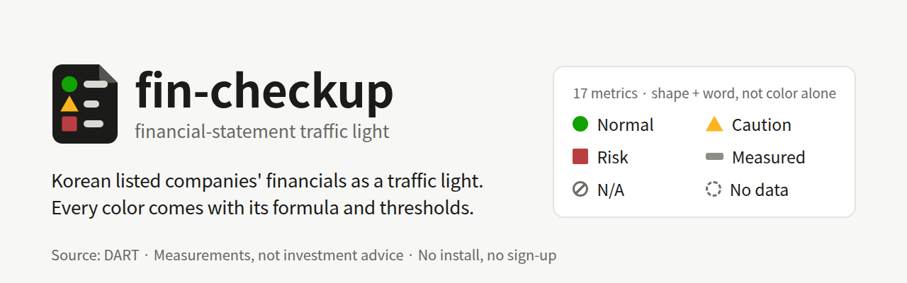
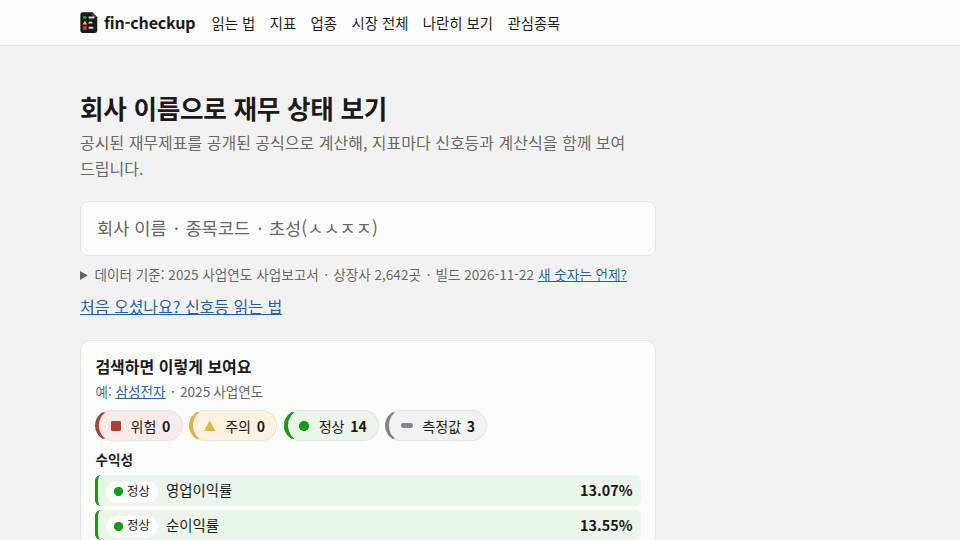

<div align="center">

**English** | [한국어](README.md)

<picture><source media="(prefers-color-scheme: dark)" srcset="docs/images/banner-en-dark.png"></picture>

# fin-checkup

**A free tool that reads listed companies' financial statements as traffic lights.**

Enter a company name to see 17 profitability, stability, and growth ratios as 🟢🟡🔴, each paired with its formula, thresholds, YoY bar, and sector box-and-whisker distribution. No install, no sign-up, and no API key required.

[](https://github.com/younghwan91/fin-checkup/actions/workflows/ci.yml) [](LICENSE) [](https://www.python.org/) [](https://www.linkedin.com/in/younghwan-chae/) [](https://glama.ai/mcp/servers/younghwan91/fin-checkup)

[Open the site](https://younghwan91.github.io/fin-checkup/) · [Samsung Electronics](https://younghwan91.github.io/fin-checkup/c/005930/) · [KB Financial](https://younghwan91.github.io/fin-checkup/c/105560/) · [How to read](https://younghwan91.github.io/fin-checkup/learn/) · [Guide (Korean)](docs/guide.md)

</div>

[](https://younghwan91.github.io/fin-checkup/c/005930/)

<p align="center"><sub>Measurements computed from filed figures. Not investment advice, and no stock recommendations. The site is in Korean only—numbers, colors, and formulas read fine as-is.</sub></p>

## Quick start

The fastest ways to plug it into an AI tool. No key or sign-up — it reads the public site data.

| Tool | One-line start |
|---|---|
| Claude Desktop | Download [`fin-checkup.mcpb`](https://github.com/younghwan91/fin-checkup/releases/latest/download/fin-checkup.mcpb) and double-click it |
| Claude Code | Run the two lines below, then ask "diagnose 005930" in a new session |
| Gemini CLI | `gemini extensions install https://github.com/younghwan91/fin-checkup` |
| Cursor · VS Code · Codex (any MCP client) | `uvx --from "fin-checkup[mcp] @ git+https://github.com/younghwan91/fin-checkup" fin-checkup-mcp` |

```bash
claude plugin marketplace add younghwan91/fin-checkup
claude plugin install fin-checkup@fin-checkup
```

- **Browse in your browser**: Search by company name or Korean initial consonants (`ㅅㅅㅈㅈ`) on the [site](https://younghwan91.github.io/fin-checkup/).
- **Ask your AI**: Paste the prompt below into ChatGPT or Claude for a table of ratios and thresholds.
- **Run from the terminal**: Developers can run the CLI locally (see [developer guide](docs/guide.md#개발자라면) for CLI, static JSON, and badges).

```bash
uv sync --all-extras
uv run python -m fin_checkup.cli checkup 005930
```

Outputs 17 traffic-light ratios with formulas, thresholds, and sector medians for a Korean listed company.

## What you get

| Signal | Meaning |
|---|---|
| 🟢 Normal · 🟡 Caution · 🔴 Risk | Compared against thresholds. Every ratio displays its exact thresholds |
| ⚪ Measured | Wide sector variation, so no threshold is applied—shows the value and sector median only |
| ⊘ N/A | Ratio does not fit the sector (e.g., debt ratio for banks); shows what to check instead |
| ⚫ No data | Account not found in the filing. Never filled with `0` |

**Example** — Samsung Electronics FY2025 operating margin **13.07% 🟢**: threshold *7%+ normal* · prior year 10.88% · above the middle 50% of 294 sector peers · sector median 2.00%.

| Section | What you can do |
|---|---|
| [Company page](https://younghwan91.github.io/fin-checkup/c/005930/) | Check the glance signal bar & summary, 17 ratio cards with box-and-whisker peer distributions, 5-year × 17-metric signal heatmap & trends, and latest quarter values |
| [Ratios](https://younghwan91.github.io/fin-checkup/m/) · [First read](https://younghwan91.github.io/fin-checkup/learn/first-read/) | Plain-language explanations of terms like operating margin and debt ratio |
| [Sectors](https://younghwan91.github.io/fin-checkup/s/) · [Market](https://younghwan91.github.io/fin-checkup/market/) | Sector × metric risk heatmap, 100%-stacked signal overview, IQR distribution charts, and company lists sorted by name |
| [Compare](https://younghwan91.github.io/fin-checkup/compare/) | Compare 2–4 companies side by side in one table |
| [Watchlist](https://younghwan91.github.io/fin-checkup/watch/) | Track signal changes for saved companies (stored only in your browser, no account) |
| Risk-disclosure feeds | Subscribe to filings (rights offerings, CBs, audit opinions) via RSS — [Whole market](https://younghwan91.github.io/fin-checkup/feeds/disclosures.xml) |

## Ask your AI agent

**1) No install — ChatGPT · Claude.ai · Perplexity**

```text
Read https://younghwan91.github.io/fin-checkup/llms.txt and follow it to diagnose Samsung Electronics' (005930) financials
```

**2) Claude Code** — run the two commands in [Quick start](#quick-start), then ask *"diagnose 005930"* in a new session.

**3) Cursor · VS Code · Claude Desktop · Codex (MCP server)** — [](https://cursor.com/en/install-mcp?name=fin-checkup&config=eyJjb21tYW5kIjoidXZ4IiwiYXJncyI6WyItLWZyb20iLCJmaW4tY2hlY2t1cFttY3BdIEAgZ2l0K2h0dHBzOi8vZ2l0aHViLmNvbS95b3VuZ2h3YW45MS9maW4tY2hlY2t1cCIsImZpbi1jaGVja3VwLW1jcCJdfQ%3D%3D) [](https://insiders.vscode.dev/redirect?url=vscode%3Amcp%2Finstall%3F%7B%22name%22%3A%22fin-checkup%22%2C%22command%22%3A%22uvx%22%2C%22args%22%3A%5B%22--from%22%2C%22fin-checkup%5Bmcp%5D%20%40%20git%2Bhttps%3A%2F%2Fgithub.com%2Fyounghwan91%2Ffin-checkup%22%2C%22fin-checkup-mcp%22%5D%7D)

- **Claude Desktop one-click**: download [`fin-checkup.mcpb`](https://github.com/younghwan91/fin-checkup/releases/latest/download/fin-checkup.mcpb) and double-click it ([details](docs/agents.md#claude-desktop-원클릭-mcpb), Korean).
- **Gemini CLI extension**: `gemini extensions install https://github.com/younghwan91/fin-checkup` — installs the MCP server together with the measurement-only rules ([`GEMINI.md`](GEMINI.md), Korean).
- **MCP server command** (requires [uv](https://docs.astral.sh/uv/getting-started/installation/) and git): `uvx --from "fin-checkup[mcp] @ git+https://github.com/younghwan91/fin-checkup" fin-checkup-mcp`
- Per-client setup is in [`docs/agents.md`](docs/agents.md) (Korean), and Codex/Cursor skills are in [`docs/agents-skill.md`](docs/agents-skill.md) (Korean).

<details>
<summary>Sample agent output (Ecopro 086520, FY2025 excerpt)</summary>

```text
에코프로 (086520, KOSDAQ): 2025 사업연도 사업보고서(연결) 기준. 신호 🟢 2 · 🟡 6 · 🔴 5 · ⚪ 3 · ⊘ 1 · ⚫ 0

| 지표       | 값      | 신호 | 계산식 / 경계값                                  | 업종 중앙값 · 작년        |
| 부채비율   | 117.92% | 🟡   | 부채총계 ÷ 자기자본 × 100 / 정상 100%↓ · 주의 200%↓ | 61.58% · 작년 112.02%     |
| 이자보상배율 | 1.58배 | 🟡   | 영업이익 ÷ 이자비용 / 정상 3배↑ · 주의 1배↑        | 4.24배 · 작년 -2.50배     |
| 현금흐름/순이익 | —  | ⊘    | 적자 구간에서는 이 비율이 뜻을 잃어 계산하지 않음 — 영업활동현금흐름을 대신 보세요 |

본 결과는 공시 수치를 공개된 재무비율 공식으로 계산한 측정값입니다. 투자권유·자문이 아니며 …
출처: https://younghwan91.github.io/fin-checkup/c/086520/ · DART
```
</details>

## Works well with

Other Korean-market tools by the same author. fin-checkup covers financial statements; these cover orders, market flows and raw data.

| Repo | What it does |
|---|---|
| [kiwoom-client](https://github.com/younghwan91/kiwoom-client) | Kiwoom REST API for Python and AI agents — 182 endpoints, real-time WebSocket, MCP server |
| [sector-flow](https://github.com/younghwan91/sector-flow) | One map of which sectors each investor type bought and sold today |
| [krx-fundamentals-client](https://github.com/younghwan91/krx-fundamentals-client) | Python library returning Korean company fundamentals from DART, KRX and Naver as Pydantic models |

## Caveats

- **Measurements only**: Not investment advice, no stock recommendations, and intentionally no composite score.
- **Data source & schedule**: Covers 2,642 companies from DART annual reports, rebuilt daily at 07:00 KST (US companies via SEC EDGAR are CLI-only).
- **Thresholds**: Calibrated to actual listed-company quantiles; rationale is documented in [`metrics/engine.py`](src/fin_checkup/metrics/engine.py).
- **Disclaimer**: The operator is not responsible for data accuracy or any gains or losses from its use.

## Docs

| Doc | What's inside |
|---|---|
| [Guide (Korean)](docs/guide.md) | FAQ, CLI usage, static JSON, badges, API keys |
| [Agent setup](docs/agents.md) · [Skills](docs/agents-skill.md) | Claude, Cursor, VS Code, Codex, Gemini CLI setup and diagnose skills |
| [Static API](docs/api-static.md) · [Embed](docs/embed.md) · [Card news](docs/card-news.md) | JSON schema, badge embedding rules, card-news generation |
| [Operations](docs/OPERATIONS.md) · [Regulatory](docs/REGULATORY.md) | Call budgets, sector rules, wording red lines |
| [Terms](docs/TERMS.md) · [Privacy](docs/PRIVACY.md) | Draft terms of service and privacy policy |

## Contributing & Support

- **Contributing**: Tests run without `.env` (`uv run pytest -q`). See [`CONTRIBUTING.md`](CONTRIBUTING.md).
- **Issues & Author**: [GitHub Issues](https://github.com/younghwan91/fin-checkup/issues) · **Younghwan Chae** ([GitHub](https://github.com/younghwan91) · [LinkedIn](https://www.linkedin.com/in/younghwan-chae/))

## License

[MIT](LICENSE) — free to use, modify, and distribute. Never include your personal DART API key in a fork or deployment.
