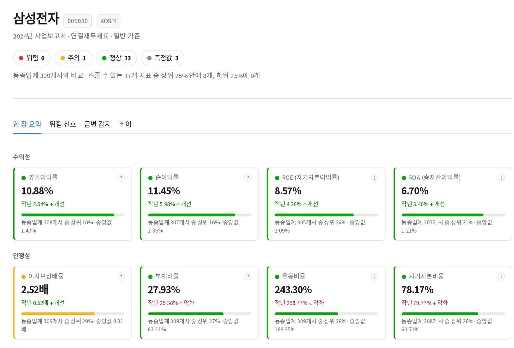
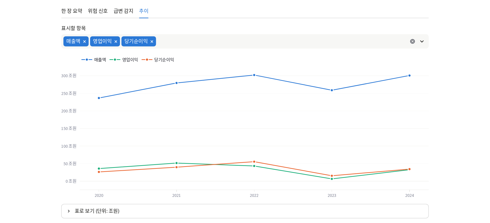
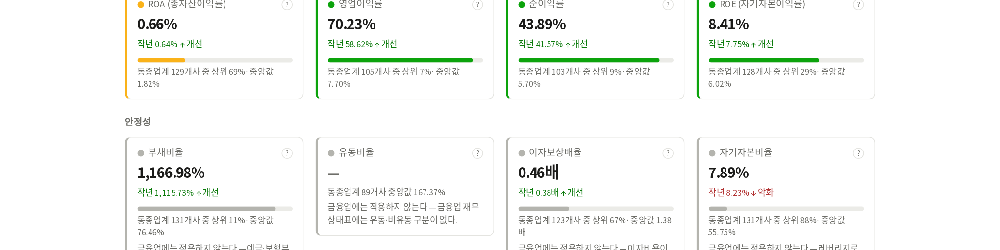

# fin-checkup

**관심 종목에 유상증자·CB·감사의견·상장폐지 같은 위험 공시가 뜨면 텔레그램으로 알리고, 재무제표는 DART·SEC EDGAR 수치를 신호등으로 보여주는 도구.** 수치와 사실만 전한다. 추천은 없다.

[](https://github.com/younghwan91/fin-checkup/actions/workflows/ci.yml)
[](LICENSE)
[](https://www.python.org/)
[](https://www.linkedin.com/in/younghwan-chae/)



- **숫자 하나에 맥락 세 겹** — "영업이익률 10.88%"가 아니라 "작년 2.54%에서 개선 · 동종업계 308개사 중 상위 10% · 중앙값 1.40%". 17개 지표 전부 계산식을 보여주고, 판정하는 14개는 경계값까지.
- **위험 공시는 대부분이 임원·대주주 소유 변동이다** — 그래서 채널은 시장 전체의 CRITICAL(부도·상장폐지)만 보내고, 내 종목은 전부 받는다.
- **없으면 없다고 한다** — 못 찾은 계정은 0이 아니라 ⚫, 업종에 안 맞는 지표는 ⊘와 "대신 볼 것". 국내는 DART, 미국은 SEC EDGAR. (텔레그램 실발송은 아직 미검증, 아래 ⚠️)

## 바로 써 보기

```bash
uv sync --all-extras                                 # CLI만 쓸 거면 `uv sync`
cp .env.example .env                                 # DART_API_KEY 는 opendart.fss.or.kr 에서 즉시 발급
uv run python -m fin_checkup.cli sync                # 종목 목록 (최초 1회)

uv run python -m fin_checkup.cli checkup 005930      # 국내 건강검진
uv run python -m fin_checkup.cli us AAPL             # 미국 (SEC EDGAR)
uv run python -m fin_checkup.cli watch add 005930    # 관심종목 등록
uv run python -m fin_checkup.cli poll --dry-run      # 위험 공시 미리보기 (보내지 않음)
uv run streamlit run src/fin_checkup/app.py          # 웹 화면
```

> 도구만 제공한다. 종목 추천·투자 판단은 하지 않는다 — 측정값 보고와 사실 전달까지.

---

## 무엇을 하나

### 위험 공시 알림

들고 있는 종목에 유상증자 공시가 떴는데 나만 며칠 뒤에 알았다. DART에는 당일 올라와 있는데 아무도 알려주지 않는다.

**부도·상장폐지·감사의견·감자·CB/BW 발행·유상증자·최대주주 변동·임원·주요주주 소유 변동** 공시를 분류해 보낸다. 전달하는 건 **어떤 공시가 떴다는 사실과 DART 원문 링크까지**다. "그러니 파세요"는 투자자문이고, 그 선은 넘지 않는다.

```bash
uv run python -m fin_checkup.cli bot --channel @채널이름
```

- **채널** — 시장 전체의 CRITICAL 공시만. 구독만 하면 되고 등록이 필요 없다.
- **봇** — `/watch 005930` 으로 등록하면 그 종목의 모든 위험 공시를 받는다.

> ⚠️ **텔레그램 실발송은 아직 검증되지 않았다.** 공시 수집·분류·중복 제거까지는 실데이터로 확인했지만, 텔레그램 API에 붙여 실제로 메시지를 보내본 적은 없다(봇 토큰 미발급, 목 테스트만 통과). 쓰려면 토큰을 발급받아 직접 확인하길 권한다.

### 재무 건강검진

17개 지표를 🟢정상 / 🟡주의 / 🔴위험 / ⚪측정값 / ⊘해당없음 / ⚫데이터없음으로 표시한다.

| 묶음 | 지표 |
|---|---|
| 수익성 | 영업이익률 · 순이익률 · ROE · ROA |
| 안정성 | 부채비율 · 유동비율 · 이자보상배율 · 자기자본비율 |
| 성장성 | 매출액/영업이익/순이익 증가율 (흑자전환·적자지속 포함) |
| 이익의 질 | 영업활동현금흐름 · OCF÷순이익 · FCF |
| 효율성 | 총자산/재고자산/매출채권 회전율 |

여기에 **위험 신호**(자본잠식·연속 영업손실·흑자 현금유출·이자보상배율 1 미만 연속)와 **급변 감지**(전기 대비 등급 하락), 5개년 **추이**가 붙는다.



기준 사업연도를 주지 않으면 오늘 날짜로 정한다 — 사업보고서 기한(3월 말)이 지난 4월부터는 직전 연도, 그 전에는 두 해 전. `--year` 로 바꾼다. 단위는 금액 크기에 맞춰 조/억을 고른다 — 300조를 "3M"으로 찍지 않는다.

---

## 왜 이렇게 만들었나

**데이터가 없으면 없다고 한다.** 공시에서 계정을 못 찾으면 0이 아니라 ⚫로 남긴다. 0으로 채우면 "부채 0원"처럼 읽혀 신호등 자체가 거짓말이 된다.

**업종이 다르면 자도 다르다.** 은행은 예금이 부채라 부채비율 1,000%가 정상이고 재고자산은 아예 없다. 실제로 KB금융을 일반 기업 기준으로 재보니 🔴가 4개 나왔다 — 국내 최대 금융지주인데도. 업종코드(KSIC)로 갈라 적용할 수 없는 지표는 ⊘로 표시하고 **대신 무엇을 봐야 하는지**를 함께 적는다.



**계산이 된다고 판정해도 되는 건 아니다.** 적자 기업의 `현금흐름÷순이익`은 뜻이 뒤집힌다. 순손실 -100에 영업현금 +50이면 비율은 -0.5지만, 적자인데 현금이 들어온 건 나쁜 신호가 아니다. 이런 구간은 판정하지 않는다.

**판단 근거를 감춘 종합 점수는 없다.** 신호등마다 설명·계산식·경계값을 같이 보여주고, 경계값은 통용 기준을 옮겨온 게 아니라 실제 시장 분위수로 맞췄다(근거는 `metrics/engine.py` 주석).

---

## 현재 상태

- 재무 검진은 전체 상장사 실데이터를 통과시켰다 — 2024년 2,759사 · 2023년 2,668사, 62개 업종군 중 99.2%가 동종업계 비교 가능.
- 텔레그램 실발송은 미검증(위 ⚠️). 공시 수집·분류·중복 제거는 실데이터로 확인.

---

## 구조

```
src/fin_checkup/
├── dart/            DART Open API + XBRL 계정 정규화 + 재시도
├── sec/             SEC EDGAR → 같은 Financials 모델
├── metrics/         지표 · 신호등 · 위험 신호 · 급변 · 업종 · 업종 비교
├── alerts/          공시 분류 · 메시지 · 텔레그램 · 워커 · 스케줄러 · 봇
├── storage/db.py    DuckDB 캐시 (원본 계정 줄을 그대로 보관)
├── api/             FastAPI (워커를 백그라운드로 함께 실행)
├── service.py       조율 계층 — UI를 모른다
├── cli.py           터미널 진입점
└── app.py           Streamlit 화면
```

CLI·Streamlit·FastAPI가 모두 `service.py`를 쓴다. 지표 엔진은 DART와 SEC 어느 쪽이든 코드 수정 없이 돈다.
API 서버는 한 프로세스가 캐시를 소유하고 알림 워커를 안에서 함께 돌린다 — DuckDB가 단일 writer라 워커를 따로 띄우면 락에서 부딪히기 때문이다.

---

## 설정·운영·개발

| 키 | 어디서 | 무엇에 |
|---|---|---|
| `DART_API_KEY` | [opendart.fss.or.kr](https://opendart.fss.or.kr) — 이메일만, 즉시 | 국내 전체 |
| `TELEGRAM_BOT_TOKEN` | [@BotFather](https://t.me/BotFather) — 무료 | 알림 |
| `SEC_USER_AGENT` | 직접 작성 (`fin-checkup you@example.com`) | 미장 |

> ⚠️ DART 약관 제19조에 따라 인증키를 제3자에게 넘기면 안 된다. `.env`는 커밋되지 않는다.

```bash
uv run python -m fin_checkup.cli budget             # 오늘 DART 호출량
uv run python -m fin_checkup.cli collect --limit 50 # 업종 비교용 캐시 채우기
uv run python -m fin_checkup.cli serve --port 8000  # HTTP API (/docs) + 알림 워커
uv run pytest                                       # 푸시마다 CI 에서도 돈다
uv run ruff check src tests scripts
```

---

## 문서

- [docs/OPERATIONS.md](./docs/OPERATIONS.md) — 운영 (프로세스 구조·호출 예산·장애 대응·실데이터 분석 스크립트)
- [docs/REGULATORY.md](./docs/REGULATORY.md) — 지켜야 하는 선 (무료로 풀어도 그대로다)
- [docs/TERMS.md](./docs/TERMS.md) · [docs/PRIVACY.md](./docs/PRIVACY.md) — 약관·방침 초안

## 라이선스

**MIT.** 가져다 쓰고 고치고 팔아도 된다. 전문은 [LICENSE](./LICENSE).

조회하는 **데이터는 애초에 내 것이 아니다.** DART는 공공데이터로 상업 이용·재배포가 허용되고 SEC EDGAR는 퍼블릭 도메인이다. 다만 DART 인증키는 개인에게 발급된 것이니 포크할 때 자기 키를 함께 넘기지 말 것 — 라이선스와 별개로 붙는 조건들은 [docs/REGULATORY.md](./docs/REGULATORY.md)에 모아뒀다.

## 면책

본 서비스는 소프트웨어 도구이며 투자권유·투자자문을 제공하지 않는다. 표시되는 정보는 공시 수치를 공개된 재무비율 공식으로 계산한 객관적 측정 결과다. 데이터 정확성 및 이용에 따른 손익에 운영자는 책임지지 않는다.

## 만든 사람

**채영환 (Younghwan Chae)** · [GitHub @younghwan91](https://github.com/younghwan91) · [LinkedIn](https://www.linkedin.com/in/younghwan-chae/)

전체 오픈소스 퀀트 스택은 [프로필](https://github.com/younghwan91)에서 한눈에 볼 수 있습니다.

## 기여 및 이슈 제보

- 🐛 버그 제보, 질문, 기능 제안: [GitHub Issues](https://github.com/younghwan91/fin-checkup/issues)
- 📈 업데이트 소식: [팔로우 @younghwan91](https://github.com/younghwan91)
