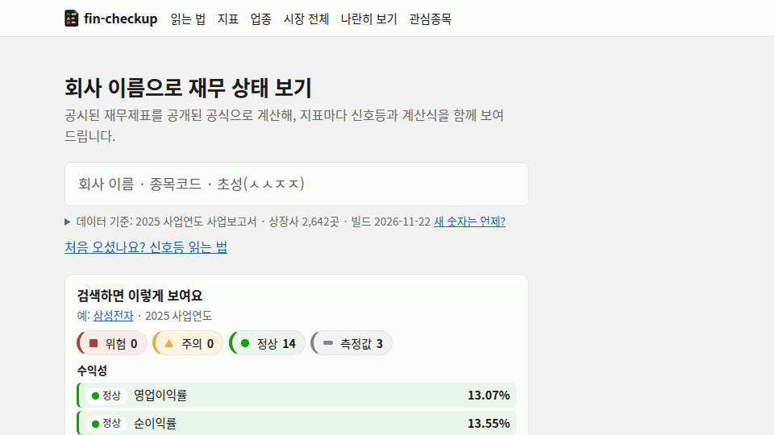

<picture><source media="(prefers-color-scheme: dark)" srcset="docs/images/banner-dark.png"></picture>

# fin-checkup

[English](README.en.md) | **한국어**

[](https://github.com/younghwan91/fin-checkup/actions/workflows/ci.yml) [](LICENSE) [](https://www.python.org/) [](https://www.linkedin.com/in/younghwan-chae/)

**상장사 재무제표를 신호등으로 읽어 주는 무료 도구.** 회사 이름만 넣으면 수익성·안정성·성장성 17개 지표가 🟢🟡🔴 로 나오고, 색마다 왜 그 색인지(계산식·기준·작년 값·같은 업종 평균)를 함께 보여 줍니다. 설치·가입·키 모두 필요 없습니다.

### ▶ 바로 보기: [younghwan91.github.io/fin-checkup](https://younghwan91.github.io/fin-checkup/)

예시: **[삼성전자 (005930)](https://younghwan91.github.io/fin-checkup/c/005930/)** · [KB금융 (105560)](https://younghwan91.github.io/fin-checkup/c/105560/) · [처음이라면: 읽는 법](https://younghwan91.github.io/fin-checkup/learn/)

[](https://younghwan91.github.io/fin-checkup/c/005930/)

> 공시 수치로 계산한 측정값입니다. 종목 추천이나 투자 판단은 하지 않습니다.

## 세 가지 방법으로 쓸 수 있어요

| 이렇게 쓰고 싶다면 | 이렇게 하세요 |
|---|---|
| **브라우저로 보기** | [사이트](https://younghwan91.github.io/fin-checkup/)에서 회사 이름이나 초성(`ㅅㅅㅈㅈ`)으로 검색하세요 |
| **AI 에게 물어보기** | ChatGPT·Claude 에 *"https://younghwan91.github.io/fin-checkup/llms.txt 를 읽고 삼성전자 재무 진단해줘"* 라고 붙여 넣으세요 → [자세히](#ai-에이전트에게-물어보기) |
| **직접 다루기 (개발자)** | CLI · 정적 JSON · 배지 → [개발자라면](#개발자라면) |

## 신호등 읽는 법

| 신호 | 뜻 |
|---|---|
| 🟢 정상 · 🟡 주의 · 🔴 위험 | 기준값과 견준 결과입니다. 기준값은 모든 지표에 적혀 있습니다 |
| ⚪ 측정값 | 업종마다 차이가 커서 기준 없이 값과 업종 중앙값만 보여 줍니다 |
| ⊘ 해당 없음 | 이 업종엔 맞지 않는 지표입니다(예: 은행의 부채비율). 대신 볼 지표를 알려 줍니다 |
| ⚫ 데이터 없음 | 공시에서 숫자를 찾지 못했습니다. 0 으로 채우지 않습니다 |

**예를 들면** — 삼성전자 2025년 영업이익률 **13.07% 🟢**: 기준 *7% 이상이면 정상* · 작년 10.88% · 같은 업종 294곳 중 상위 10% · 업종 중앙값 2.00%.
종합 점수는 일부러 만들지 않았습니다. 근거를 감춘 점수는 오해를 부르기 때문입니다.

## AI 에이전트에게 물어보기

에이전트에게 "삼성전자 재무 진단해줘" 라고 물으면 이 데이터로 지표·계산식·기준을 표로 답합니다. 키도 가입도 필요 없습니다. "지금 사도 돼?" 처럼 판단을 물으면 판단은 하지 않고 숫자만 보여 줍니다.

**1) 설치 없이 — ChatGPT · Claude.ai · Perplexity**

```text
https://younghwan91.github.io/fin-checkup/llms.txt 를 읽고 그 방법대로 삼성전자 재무 진단해줘
```

**2) Claude Code** — 두 줄 입력 후 새 세션에서 "진단해줘" 라고 물어보세요.

```bash
claude plugin marketplace add younghwan91/fin-checkup
claude plugin install fin-checkup@fin-checkup
```

**3) Cursor · VS Code · Claude Desktop · Codex (MCP 서버)** — [](https://cursor.com/en/install-mcp?name=fin-checkup&config=eyJjb21tYW5kIjoidXZ4IiwiYXJncyI6WyItLWZyb20iLCJmaW4tY2hlY2t1cFttY3BdIEAgZ2l0K2h0dHBzOi8vZ2l0aHViLmNvbS95b3VuZ2h3YW45MS9maW4tY2hlY2t1cCIsImZpbi1jaGVja3VwLW1jcCJdfQ%3D%3D) [](https://insiders.vscode.dev/redirect?url=vscode%3Amcp%2Finstall%3F%7B%22name%22%3A%22fin-checkup%22%2C%22command%22%3A%22uvx%22%2C%22args%22%3A%5B%22--from%22%2C%22fin-checkup%5Bmcp%5D%20%40%20git%2Bhttps%3A%2F%2Fgithub.com%2Fyounghwan91%2Ffin-checkup%22%2C%22fin-checkup-mcp%22%5D%7D)

**Claude Desktop 은 파일 하나로:** [`fin-checkup.mcpb`](https://github.com/younghwan91/fin-checkup/releases/latest/download/fin-checkup.mcpb) 를 받아 두 번 누르면 설치됩니다 (uv·git 불필요, DART 키 칸은 선택) — [자세히](docs/agents.md#claude-desktop-원클릭-mcpb)

모든 MCP 클라이언트는 아래 명령으로 서버를 실행합니다 (Claude Code에서 MCP만 단독 연결할 때는 앞에 `claude mcp add fin-checkup --` 을 붙이세요):

```bash
uvx --from "fin-checkup[mcp] @ git+https://github.com/younghwan91/fin-checkup" fin-checkup-mcp
```

[uv](https://docs.astral.sh/uv/getting-started/installation/) 와 git 이 필요합니다. 프로그램별 설정은 [`docs/agents.md`](docs/agents.md), Codex·Cursor 에서 같은 진단 스킬을 쓰는 법은 [`docs/agents-skill.md`](docs/agents-skill.md) 에 있습니다. 설치가 어렵다면 에이전트에게 *"fin-checkup 설치해줘"* 라고 해 보세요 — 설치부터 (원할 때) DART 키 발급까지 안내합니다.

<details>
<summary>실제 답은 이렇게 나와요 (에코프로, 2025 사업연도 일부)</summary>

```text
에코프로 (086520, KOSDAQ): 2025 사업연도 사업보고서(연결) 기준. 신호 🟢 2 · 🟡 6 · 🔴 5 · ⚪ 3 · ⊘ 1 · ⚫ 0

| 지표       | 값      | 신호 | 계산식 / 경계값                                  | 업종 중앙값 · 작년        |
| 부채비율   | 117.92% | 🟡   | 부채총계 ÷ 자기자본 × 100 / 정상 100%↓ · 주의 200%↓ | 61.58% · 작년 112.02%     |
| 이자보상배율 | 1.58배 | 🟡   | 영업이익 ÷ 이자비용 / 정상 3배↑ · 주의 1배↑        | 4.24배 · 작년 -2.50배     |
| 현금흐름/순이익 | —  | ⊘    | 적자 구간에서는 이 비율이 뜻을 잃어 계산하지 않음 — 영업활동현금흐름을 대신 보세요 |

본 결과는 공시 수치를 공개된 재무비율 공식으로 계산한 측정값입니다. 투자권유·자문이 아니며 …
출처: https://younghwan91.github.io/fin-checkup/c/086520/ · DART
```
</details>

## 사이트에서 할 수 있는 것

| 메뉴 | 할 수 있는 일 |
|---|---|
| [회사 페이지](https://younghwan91.github.io/fin-checkup/c/005930/) | 지표 17개 신호등, 위험 신호(자본잠식·연속 영업손실 등), 5년 추이 확인 |
| [지표 해설](https://younghwan91.github.io/fin-checkup/m/) · [처음 읽기](https://younghwan91.github.io/fin-checkup/learn/first-read/) | 영업이익률·부채비율 같은 용어를 쉬운 말로 확인 |
| [업종](https://younghwan91.github.io/fin-checkup/s/) · [시장 전체](https://younghwan91.github.io/fin-checkup/market/) | 업종별·시장 전체 분포와 업종별 회사 목록(이름순) 확인 |
| [나란히 보기](https://younghwan91.github.io/fin-checkup/compare/) | 2~4곳을 한 표에 나란히 비교 |
| [관심종목](https://younghwan91.github.io/fin-checkup/watch/) | 담아 둔 회사가 지난번 이후 어떻게 바뀌었는지 확인 (브라우저에만 저장, 계정 없음) |
| 위험 공시 피드 | 유상증자·CB·감사의견·상장폐지 같은 공시를 RSS 리더·Slack·Discord 로 구독 — [시장 전체](https://younghwan91.github.io/fin-checkup/feeds/disclosures.xml) · 회사별 `feeds/c/<종목코드>.xml` |

## 자주 묻는 것

<details>
<summary>사라·팔라고 알려 주나요?</summary>

아닙니다. 공시 숫자를 공개된 공식으로 계산한 **측정값**만 보여 줍니다. 무엇을 사고팔지는 말하지 않고, 지표 순위표도 만들지 않습니다. 지키는 선은 [docs/REGULATORY.md](docs/REGULATORY.md) 에 있습니다.
</details>

<details>
<summary>데이터는 어디서 오고 언제 바뀌나요?</summary>

금융감독원 전자공시(DART) 사업보고서입니다. 코스피 829 · 코스닥 1,798 · 코넥스 15 — 2,642곳의 2025년 값과 2021년부터의 추이가 있습니다. 사이트는 매일 07:00(KST)에 다시 만들어지며, 위험 공시는 매일, 재무제표는 새 사업보고서가 나오면 반영됩니다. 브라우저와 AI 에이전트는 이 정적 사이트만 읽습니다.
</details>

<details>
<summary>기준값(🟢/🟡/🔴 경계)은 누가 정했나요?</summary>

교과서 기준을 그대로 옮겨 오지 않고 실제 상장사 분포(분위수)에 맞췄습니다. 근거는 [`metrics/engine.py`](src/fin_checkup/metrics/engine.py) 주석에 있고, 모든 지표 옆에 기준이 적혀 있습니다. 같은 업종 비교는 업종코드(KSIC 앞 두 자리) 기준이며, 업종 표본이 5곳 미만이면 전체 상장사와 견줍니다.
</details>

<details>
<summary>숫자가 이상해요.</summary>

회사 코드·지표·DART 원문 링크와 함께 [이슈 "데이터가 이상해요"](https://github.com/younghwan91/fin-checkup/issues/new/choose) 로 알려 주세요. 실제로 이자보상배율·FCF·매출 증가율 같은 계산 오류를 사용자 관점 점검으로 여럿 고쳤습니다.
</details>

## 개발자라면

**CLI** — 국내는 DART, 미국 상장사는 SEC EDGAR 를 씁니다(미국 기업은 CLI 에서만 지원합니다).

```bash
uv sync --all-extras
uv run python -m fin_checkup.cli setup          # DART 키 넣기 — 화면·로그에 남기지 않음 (사이트·에이전트는 키 불필요)
uv run python -m fin_checkup.cli sync           # 종목 목록 (최초 1회)
uv run python -m fin_checkup.cli checkup 005930 # 국내 건강검진
uv run python -m fin_checkup.cli us AAPL        # 미국 (SEC_USER_AGENT 필요)
uv run python -m fin_checkup.cli --help         # watch · poll · serve · site build …
```

**정적 JSON** — 회사 페이지와 같은 값이며 키·호출 제한이 없습니다. 필드는 [`docs/api-static.md`](docs/api-static.md), 명세는 [`openapi.json`](https://younghwan91.github.io/fin-checkup/openapi.json), 예제는 [`examples/`](examples/README.md) 에서 볼 수 있습니다.

```bash
curl -s https://younghwan91.github.io/fin-checkup/api/c/005930.json | jq '.metrics[] | {label, value_text, signal: .signal.emoji}'
```

**배지** — 블로그·README 용 신호 개수 배지입니다. 근거가 있는 회사 페이지로 꼭 감싸 주세요([`docs/embed.md`](docs/embed.md)). 카드뉴스 생성은 [`docs/card-news.md`](docs/card-news.md) 에 있습니다.

```markdown
[](https://younghwan91.github.io/fin-checkup/c/005930/)
```

**기여** — 테스트는 `.env` 없이 돕니다(`uv run pytest -q`). 해설·용어집·업종 설명을 고치는 법은 [`CONTRIBUTING.md`](CONTRIBUTING.md) 에 있습니다.

<details>
<summary>키와 알림 채널</summary>

| 키 | 어디서 | 무엇에 |
|---|---|---|
| `DART_API_KEY` | [opendart.fss.or.kr](https://opendart.fss.or.kr) — 이메일만, 즉시 | CLI 로 국내 기업 직접 수집 |
| `SEC_USER_AGENT` | 직접 작성 (`fin-checkup you@example.com`) | 미국 기업 수집 |
| `TELEGRAM_BOT_TOKEN` | [@BotFather](https://t.me/BotFather) — 무료 | 텔레그램 봇 (실제 발송은 아직 검증되지 않았으며, 현재 동작하는 알림은 RSS/Atom 피드입니다) |

DART 약관 제19조에 따라 인증키를 다른 사람에게 넘기면 안 됩니다. `.env` 는 커밋되지 않습니다.
운영 문서: [OPERATIONS](docs/OPERATIONS.md) · [REGULATORY](docs/REGULATORY.md) · [TERMS](docs/TERMS.md) · [PRIVACY](docs/PRIVACY.md)
</details>

## 라이선스

**MIT 라이선스**를 따릅니다. 자유롭게 가져다 쓰고 수정하고 상업적으로 이용할 수 있습니다. 전문은 [LICENSE](./LICENSE) 에 있습니다.

조회하는 데이터는 fin-checkup 의 소유가 아닙니다. DART(OpenDART) 약관에는 영리 이용·재배포를 금지하는 조항이 없고 공공데이터법을 따릅니다(명시적 허용 문구는 없습니다). SEC EDGAR 는 퍼블릭 도메인입니다. 다만 DART 인증키는 개인에게 발급되므로 포크하거나 배포할 때 본인 키를 포함하지 마세요. 라이선스 외에 지켜야 할 조건은 [docs/REGULATORY.md](docs/REGULATORY.md) 에 정리되어 있습니다.

## 면책

본 서비스는 소프트웨어 도구이며 투자권유·투자자문을 제공하지 않습니다. 본 결과는 공시 수치를 공개된 재무비율 공식으로 계산한 측정값입니다. 투자권유·자문이 아니며, 데이터 정확성과 이용에 따른 손익에 책임지지 않습니다.

## 만든 사람

**채영환 (Younghwan Chae)** · [GitHub @younghwan91](https://github.com/younghwan91) · [LinkedIn](https://www.linkedin.com/in/younghwan-chae/)

전체 오픈소스 퀀트 스택은 [프로필](https://github.com/younghwan91)에서 한눈에 볼 수 있습니다.

## 기여 및 이슈 제보

- 🐛 버그 제보, 질문, 기능 제안: [GitHub Issues](https://github.com/younghwan91/fin-checkup/issues)
- 📈 업데이트 소식: [팔로우 @younghwan91](https://github.com/younghwan91)
