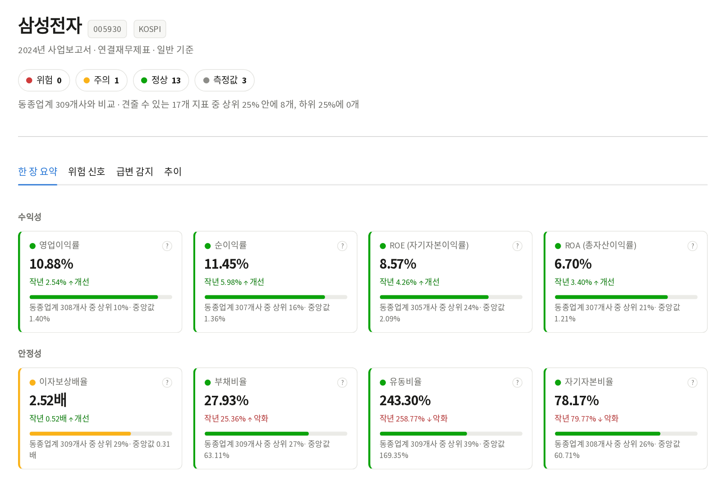

# fin-checkup

[English](README.en.md) | **한국어**

**"영업이익률 13.07%" — 높은 걸까요?** 삼성전자 2025년 값입니다. 작년 10.88%, 같은 업종 294개사 중 상위 10%, 업종 중앙값 2.00%.
상장사 2,642곳의 재무제표를 신호등(🟢🟡🔴)으로 보여 주고, 색마다 계산식과 경계값을 붙였습니다. 설치도 가입도 필요 없습니다.

## ▶ 바로 보기: [younghwan91.github.io/fin-checkup](https://younghwan91.github.io/fin-checkup/)

예시 **[삼성전자](https://younghwan91.github.io/fin-checkup/c/005930/)** · [KB금융](https://younghwan91.github.io/fin-checkup/c/105560/) · [처음이라면: 읽는 법](https://younghwan91.github.io/fin-checkup/learn/) · [지표 17개 해설](https://younghwan91.github.io/fin-checkup/m/)

[](https://younghwan91.github.io/fin-checkup/c/005930/)

> 공시 수치로 계산한 측정값입니다. 종목 추천이나 투자 판단은 하지 않습니다.

[](https://github.com/younghwan91/fin-checkup/actions/workflows/ci.yml)
[](LICENSE)
[](https://www.python.org/)
[](https://www.linkedin.com/in/younghwan-chae/)

## 세 가지

- **코스피 829 · 코스닥 1,798 · 코넥스 15 — 2,642곳, 2025 사업보고서 기준.** 출처는 금융감독원 전자공시(DART)이고, 2022년부터의 값으로 작년 대비와 추이를 함께 봅니다.
- **숫자 하나에 맥락 세 겹.** 지표 17개마다 계산식 · 작년 값 · 같은 업종(KSIC 앞 두 자리) 안에서의 위치와 중앙값을 보여 줍니다. 영업이익률 기준 98.7%(2,607곳)는 같은 업종 5곳 이상과 견주고, 업종 표본이 모자라면 전체 상장사와 견줍니다. 경계값은 통용 기준을 옮겨 온 게 아니라 실제 시장 분위수로 맞췄습니다(근거는 [`metrics/engine.py`](src/fin_checkup/metrics/engine.py) 주석).
- **없으면 없다고 합니다.** 못 찾은 계정은 0이 아니라 ⚫, 업종에 안 맞는 지표는 ⊘와 "대신 볼 것". 은행은 예금이 부채로 잡혀 [KB금융](https://younghwan91.github.io/fin-checkup/c/105560/)의 부채비율 1,211.73%가 정상이라 판정하지 않고 BIS 자기자본비율을 보라고 적습니다. 판단 근거를 감춘 종합 점수는 없습니다.

## 사이트에서 할 수 있는 것

| | |
|---|---|
| [회사 페이지](https://younghwan91.github.io/fin-checkup/c/005930/) | 지표 17개 신호등, 위험 신호(자본잠식·연속 영업손실 등), 5개년 추이 |
| [지표](https://younghwan91.github.io/fin-checkup/m/) · [업종](https://younghwan91.github.io/fin-checkup/s/) · [시장 전체](https://younghwan91.github.io/fin-checkup/market/) | 지표별 해설과 분포, 업종별 회사 목록(이름순) |
| [나란히 보기](https://younghwan91.github.io/fin-checkup/compare/) | 여러 회사를 한 표에 |
| [관심종목](https://younghwan91.github.io/fin-checkup/watch/) | 담아 둔 회사의 신호 변화. 이 브라우저에만 저장되고 계정이 없습니다 |

### 위험 공시 받아 보기 — 피드

유상증자·CB/BW 발행·감사의견·상장폐지 같은 위험 공시를 **Atom 피드**로 받습니다. RSS 리더나 Slack·Discord 의 RSS 앱에 주소를 넣으면 됩니다. 전하는 건 공시가 떴다는 사실과 DART 원문 링크까지입니다. 사이트와 피드는 매일 07:00(KST)에 다시 빌드됩니다.

- 시장 전체(심각 공시만): `https://younghwan91.github.io/fin-checkup/feeds/disclosures.xml`
- 회사별(신호 변화 + 그 회사 위험 공시): `https://younghwan91.github.io/fin-checkup/feeds/c/005930.xml`

> ⚠️ 텔레그램 봇(`cli bot`)도 들어 있지만 실제 발송은 검증하지 않았습니다(봇 토큰 미발급, 목 테스트만 통과). 지금 동작하는 알림 경로는 피드입니다.

## 개발자라면

**CLI** — 국내는 DART, 미국 상장사는 SEC EDGAR(미국 기업은 CLI 에서만 봅니다).

```bash
uv sync --all-extras                                 # CLI만 쓸 거면 `uv sync`
cp .env.example .env                                 # DART_API_KEY 는 opendart.fss.or.kr 에서 즉시 발급
uv run python -m fin_checkup.cli sync                # 종목 목록 (최초 1회)
uv run python -m fin_checkup.cli checkup 005930      # 국내 건강검진
uv run python -m fin_checkup.cli us AAPL             # 미국 (SEC_USER_AGENT 필요)
uv run python -m fin_checkup.cli --help              # watch · poll · serve(FastAPI) · site build …
```

**JSON** — 회사 페이지와 같은 값을 정적 JSON 으로. 키도 호출 제한도 없습니다. 필드 설명은 [`docs/api-static.md`](docs/api-static.md), 쓰는 예는 [`examples/`](examples/README.md).

```bash
curl -s https://younghwan91.github.io/fin-checkup/api/c/005930.json | jq '.metrics[] | {label, value_text, signal: .signal.emoji}'
```

**배지** — 블로그·README 에 붙이는 신호 개수 배지. 근거가 있는 회사 페이지로 꼭 감싸 주세요([`docs/embed.md`](docs/embed.md)). 카드뉴스 이미지는 [`docs/card-news.md`](docs/card-news.md).

```markdown
[](https://younghwan91.github.io/fin-checkup/c/005930/)
```

**에이전트** — Claude Code 에서 `/plugin marketplace add younghwan91/fin-checkup` → `/plugin install fin-checkup@fin-checkup` 하면 "삼성전자 재무 진단해줘" 에 답한다. Codex·Cursor·ChatGPT 는 [`docs/agents-skill.md`](docs/agents-skill.md).

**기여** — 테스트는 `.env` 없이 돕니다(`uv run pytest -q`). 지표 해설·용어집·업종 설명 고치는 법과 넘지 않는 선은 [`CONTRIBUTING.md`](CONTRIBUTING.md).

| 키 | 어디서 | 무엇에 |
|---|---|---|
| `DART_API_KEY` | [opendart.fss.or.kr](https://opendart.fss.or.kr) — 이메일만, 즉시 | 국내 전체 |
| `SEC_USER_AGENT` | 직접 작성 (`fin-checkup you@example.com`) | 미국 |
| `TELEGRAM_BOT_TOKEN` | [@BotFather](https://t.me/BotFather) — 무료 | 텔레그램 봇 (미검증) |

> ⚠️ DART 약관 제19조에 따라 인증키를 제3자에게 넘기면 안 됩니다. `.env`는 커밋되지 않습니다.

## 문서

- [docs/OPERATIONS.md](./docs/OPERATIONS.md) — 운영 (프로세스 구조·호출 예산·정적 사이트 빌드·장애 대응)
- [docs/REGULATORY.md](./docs/REGULATORY.md) — 지켜야 하는 선
- [docs/TERMS.md](./docs/TERMS.md) · [docs/PRIVACY.md](./docs/PRIVACY.md) — 약관·방침 초안

## 라이선스

**MIT.** 가져다 쓰고 고치고 팔아도 된다. 전문은 [LICENSE](./LICENSE).

조회하는 **데이터는 애초에 내 것이 아니다.** DART는 공공데이터로 상업 이용·재배포가 허용되고 SEC EDGAR는 퍼블릭 도메인이다. 다만 DART 인증키는 개인에게 발급된 것이니 포크할 때 자기 키를 함께 넘기지 말 것 — 라이선스와 별개로 붙는 조건들은 [docs/REGULATORY.md](./docs/REGULATORY.md)에 모아뒀다.

## 면책

본 서비스는 소프트웨어 도구이며 투자권유·투자자문을 제공하지 않는다. 표시되는 정보는 공시 수치를 공개된 재무비율 공식으로 계산한 객관적 측정 결과다. 데이터 정확성 및 이용에 따른 손익에 운영자는 책임지지 않는다.

## 만든 사람

**채영환 (Younghwan Chae)** · [GitHub @younghwan91](https://github.com/younghwan91) · [LinkedIn](https://www.linkedin.com/in/younghwan-chae/)

전체 오픈소스 퀀트 스택은 [프로필](https://github.com/younghwan91)에서 한눈에 볼 수 있습니다.

## 기여 및 이슈 제보

- 🐛 버그 제보, 질문, 기능 제안: [GitHub Issues](https://github.com/younghwan91/fin-checkup/issues)
- 📈 업데이트 소식: [팔로우 @younghwan91](https://github.com/younghwan91)
