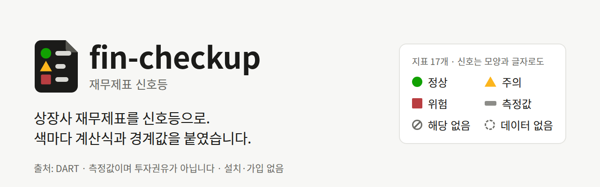

<div align="center">

[English](README.en.md) | **한국어**

<picture><source media="(prefers-color-scheme: dark)" srcset="docs/images/banner-dark.png"></picture>

# fin-checkup

**상장사 재무제표를 신호등으로 읽어 주는 무료 도구입니다.**

회사 이름만 넣으면 수익성·안정성·성장성 17개 지표가 🟢🟡🔴 로 나오며, 색마다 계산식·기준·작년 값·동종업계 분포를 함께 보여 드립니다. 설치·가입·API 키가 필요 없습니다.

[](https://github.com/younghwan91/fin-checkup/actions/workflows/ci.yml) [](LICENSE) [](https://www.python.org/) [](https://www.linkedin.com/in/younghwan-chae/) [](https://glama.ai/mcp/servers/younghwan91/fin-checkup)

[사이트 바로가기](https://younghwan91.github.io/fin-checkup/) · [삼성전자 예시](https://younghwan91.github.io/fin-checkup/c/005930/) · [KB금융 예시](https://younghwan91.github.io/fin-checkup/c/105560/) · [처음 읽기](https://younghwan91.github.io/fin-checkup/learn/) · [상세 안내](docs/guide.md) · [블로그](https://velog.io/@younghwan91/%ED%9A%8C%EC%82%AC-%EC%9D%B4%EB%A6%84%EB%A7%8C-%EB%84%A3%EC%9C%BC%EB%A9%B4-%EC%9E%AC%EB%AC%B4%EC%A0%9C%ED%91%9C-17%EA%B0%9C-%EC%A7%80%ED%91%9C%EB%A5%BC-%EC%8B%A0%ED%98%B8%EB%93%B1%EC%9C%BC%EB%A1%9C-%EA%B3%84%EC%82%B0%EC%8B%9D%EA%B3%BC-%EA%B8%B0%EC%A4%80%EA%B9%8C%EC%A7%80-%EA%B3%B5%EA%B0%9C%ED%96%88%EC%8A%B5%EB%8B%88%EB%8B%A4)

</div>

[](https://younghwan91.github.io/fin-checkup/c/005930/)

<p align="center"><sub>공시 수치로 계산한 측정값입니다. 종목 추천이나 투자 판단은 하지 않습니다.</sub></p>

## 바로 시작하기

AI 도구에 연결하는 가장 빠른 세 가지 방법입니다. 키·가입 없이 공개 사이트 데이터를 읽습니다.

| 쓰는 도구 | 한 줄로 시작하기 |
|---|---|
| Claude Desktop | [`fin-checkup.mcpb`](https://github.com/younghwan91/fin-checkup/releases/latest/download/fin-checkup.mcpb) 를 받아 두 번 누릅니다 |
| Claude Code | 아래 두 줄을 입력한 뒤 새 세션에서 "삼성전자 재무 진단해줘" 라고 묻습니다 |
| Cursor · VS Code · Codex 등 MCP | `uvx --from "fin-checkup[mcp] @ git+https://github.com/younghwan91/fin-checkup" fin-checkup-mcp` |

```bash
claude plugin marketplace add younghwan91/fin-checkup
claude plugin install fin-checkup@fin-checkup
```

- **브라우저에서 보기**: [사이트](https://younghwan91.github.io/fin-checkup/)에서 회사 이름이나 초성(`ㅅㅅㅈㅈ`)으로 바로 검색합니다.
- **AI 에게 물어보기**: ChatGPT·Claude 에 아래 문장을 붙여 넣으면 표와 계산식으로 답합니다.
- **터미널에서 실행하기**: 개발자라면 로컬에서 직접 실행할 수 있습니다([자세한 CLI·JSON·배지 안내](docs/guide.md#개발자라면)).

```bash
uv sync --all-extras
uv run python -m fin_checkup.cli checkup 005930
```

실행하면 국내 상장사의 17개 재무 지표 신호등과 계산식·경계값·업종 중앙값이 출력됩니다.

## 무엇을 볼 수 있나요

| 신호 | 뜻 |
|---|---|
| 🟢 정상 · 🟡 주의 · 🔴 위험 | 기준값과 견준 결과입니다. 기준값은 모든 지표에 적혀 있습니다 |
| ⚪ 측정값 | 업종마다 차이가 커서 기준 없이 값과 업종 중앙값만 보여 드립니다 |
| ⊘ 해당 없음 | 이 업종에 맞지 않는 지표입니다(예: 은행의 부채비율). 대신 볼 지표를 알려 드립니다 |
| ⚫ 데이터 없음 | 공시에서 숫자를 찾지 못했습니다. 0 으로 채우지 않습니다 |

**예시** — 삼성전자 2025년 영업이익률 **13.07% 🟢**: 기준 *7% 이상이면 정상* · 작년 10.88% · 같은 업종 294곳 중 상위 10% · 업종 중앙값 2.00%.

| 메뉴 | 할 수 있는 일 |
|---|---|
| [회사 페이지](https://younghwan91.github.io/fin-checkup/c/005930/) | 지표 17개 신호등, 위험 신호(자본잠식·연속 영업손실 등), 5년 추이를 확인합니다 |
| [지표 해설](https://younghwan91.github.io/fin-checkup/m/) · [처음 읽기](https://younghwan91.github.io/fin-checkup/learn/first-read/) | 영업이익률·부채비율 같은 용어를 쉬운 말로 확인합니다 |
| [업종](https://younghwan91.github.io/fin-checkup/s/) · [시장 전체](https://younghwan91.github.io/fin-checkup/market/) | 업종별·시장 전체 분포와 업종별 회사 목록(이름순)을 확인합니다 |
| [나란히 보기](https://younghwan91.github.io/fin-checkup/compare/) | 2~4곳을 한 표에 나란히 비교합니다 |
| [관심종목](https://younghwan91.github.io/fin-checkup/watch/) | 담아 둔 회사의 변화를 확인합니다(브라우저에만 저장, 계정 없음) |
| 위험 공시 피드 | 유상증자·CB·감사의견·상장폐지 공시를 RSS 로 구독합니다 — [시장 전체](https://younghwan91.github.io/fin-checkup/feeds/disclosures.xml) |

## AI 에이전트 연동

**1) 설치 없이 — ChatGPT · Claude.ai · Perplexity**

```text
https://younghwan91.github.io/fin-checkup/llms.txt 를 읽고 그 방법대로 삼성전자 재무 진단해줘
```

**2) Claude Code** — [바로 시작하기](#바로-시작하기)의 두 줄을 입력한 뒤 새 세션에서 "진단해줘" 라고 물어보세요.

**3) Cursor · VS Code · Claude Desktop · Codex (MCP 서버)** — [](https://cursor.com/en/install-mcp?name=fin-checkup&config=eyJjb21tYW5kIjoidXZ4IiwiYXJncyI6WyItLWZyb20iLCJmaW4tY2hlY2t1cFttY3BdIEAgZ2l0K2h0dHBzOi8vZ2l0aHViLmNvbS95b3VuZ2h3YW45MS9maW4tY2hlY2t1cCIsImZpbi1jaGVja3VwLW1jcCJdfQ%3D%3D) [](https://insiders.vscode.dev/redirect?url=vscode%3Amcp%2Finstall%3F%7B%22name%22%3A%22fin-checkup%22%2C%22command%22%3A%22uvx%22%2C%22args%22%3A%5B%22--from%22%2C%22fin-checkup%5Bmcp%5D%20%40%20git%2Bhttps%3A%2F%2Fgithub.com%2Fyounghwan91%2Ffin-checkup%22%2C%22fin-checkup-mcp%22%5D%7D)

- **Claude Desktop 원클릭**: [`fin-checkup.mcpb`](https://github.com/younghwan91/fin-checkup/releases/latest/download/fin-checkup.mcpb) 를 받아 두 번 누르면 설치됩니다([자세히](docs/agents.md#claude-desktop-원클릭-mcpb)).
- **MCP 서버 명령** ([uv](https://docs.astral.sh/uv/getting-started/installation/)·git 필요): `uvx --from "fin-checkup[mcp] @ git+https://github.com/younghwan91/fin-checkup" fin-checkup-mcp`
- 프로그램별 설정은 [`docs/agents.md`](docs/agents.md), Codex·Cursor 스킬은 [`docs/agents-skill.md`](docs/agents-skill.md) 에 있습니다.

<details>
<summary>에이전트 응답 예시 (에코프로, 2025 사업연도 일부)</summary>

```text
에코프로 (086520, KOSDAQ): 2025 사업연도 사업보고서(연결) 기준. 신호 🟢 2 · 🟡 6 · 🔴 5 · ⚪ 3 · ⊘ 1 · ⚫ 0

| 지표       | 값      | 신호 | 계산식 / 경계값                                  | 업종 중앙값 · 작년        |
| 부채비율   | 117.92% | 🟡   | 부채총계 ÷ 자기자본 × 100 / 정상 100%↓ · 주의 200%↓ | 61.58% · 작년 112.02%     |
| 이자보상배율 | 1.58배 | 🟡   | 영업이익 ÷ 이자비용 / 정상 3배↑ · 주의 1배↑        | 4.24배 · 작년 -2.50배     |
| 현금흐름/순이익 | —  | ⊘    | 적자 구간에서는 이 비율이 뜻을 잃어 계산하지 않음 — 영업활동현금흐름을 대신 보세요 |

본 결과는 공시 수치를 공개된 재무비율 공식으로 계산한 측정값입니다. 투자권유·자문이 아니며 …
출처: https://younghwan91.github.io/fin-checkup/c/086520/ · DART
```
</details>

## 같이 쓰면 좋은 것

같은 사람이 만든 한국 주식 도구입니다. fin-checkup 은 재무제표를, 아래 도구는 주문·수급·원천 데이터를 다룹니다.

| 레포 | 하는 일 |
|---|---|
| [kiwoom-client](https://github.com/younghwan91/kiwoom-client) | 키움 REST API 를 파이썬과 AI 에이전트로 씁니다 — 엔드포인트 182개·실시간 WebSocket·MCP 서버 |
| [sector-flow](https://github.com/younghwan91/sector-flow) | 오늘 어느 섹터로 돈이 들고 났는지, 투자 주체별 순매매를 지도 한 장으로 봅니다 |
| [krx-fundamentals-client](https://github.com/younghwan91/krx-fundamentals-client) | DART·KRX·네이버의 기업 펀더멘털을 Pydantic 모델로 받는 파이썬 라이브러리입니다 |

## 유의할 점

- **측정값만 제공합니다**: 종목 추천이나 투자 판단은 하지 않습니다. 근거를 감춘 종합 점수도 만들지 않습니다.
- **데이터 출처와 갱신**: 금융감독원 전자공시(DART) 사업보고서 기준 2,642곳을 다루며, 사이트는 매일 07:00(KST)에 다시 만들어집니다(미국 기업은 CLI 에서만 지원합니다).
- **경계값 근거**: 🟢/🟡/🔴 경계는 실제 상장사 분포(분위수)에 맞췄으며 [`metrics/engine.py`](src/fin_checkup/metrics/engine.py) 주석에 근거가 있습니다.
- **면책**: 데이터 정확성과 이용에 따른 손익에 책임지지 않습니다.

## 문서

| 문서 | 내용 |
|---|---|
| [상세 안내](docs/guide.md) | 자주 묻는 질문, CLI·정적 JSON·배지 사용법, API 키 안내 |
| [에이전트 설정](docs/agents.md) · [스킬](docs/agents-skill.md) | Claude·Cursor·VS Code·Codex 연동 및 진단 스킬 |
| [정적 API](docs/api-static.md) · [배지](docs/embed.md) · [카드뉴스](docs/card-news.md) | JSON 필드 명세, 배지 삽입 규칙, 카드뉴스 생성 |
| [운영](docs/OPERATIONS.md) · [규제 원칙](docs/REGULATORY.md) | 호출 예산, 업종 판정 기준, 표현 원칙 |
| [약관](docs/TERMS.md) · [개인정보](docs/PRIVACY.md) | 서비스 약관 및 개인정보 처리방침 초안 |

## 기여 및 문의

- **기여**: 테스트는 `.env` 없이 돕니다(`uv run pytest -q`). 자세한 규칙은 [`CONTRIBUTING.md`](CONTRIBUTING.md) 에 있습니다.
- **이슈 및 문의**: [GitHub Issues](https://github.com/younghwan91/fin-checkup/issues) · 만든 사람 **채영환 (Younghwan Chae)** ([GitHub](https://github.com/younghwan91) · [LinkedIn](https://www.linkedin.com/in/younghwan-chae/))

## 라이선스

[MIT](LICENSE) — 자유롭게 쓰고 수정할 수 있습니다. DART 인증키는 개인에게 발급되므로 포크나 배포물에 본인 키를 넣지 마세요.
